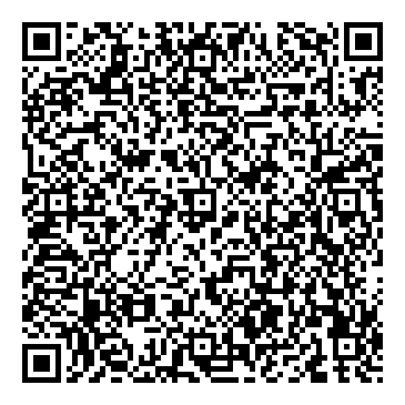
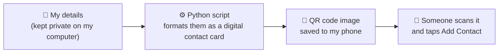

# contact-qr

**Share my contact info in one scan.** I built this tool to turn my contact details into a QR code. Someone points their phone camera at it, taps "Add Contact," and my name, job title, phone, email, website, and LinkedIn are saved to their phone. No typing, no app, no internet needed.

<p align="center">
  <br>
  <em>Try it: scan this sample with your phone camera.<br>It holds placeholder details for "Alex Sample," not real contact info.</em>
</p>

---

## Why I built it

Networking events move fast. Swapping contact info usually means one of these:

- **Typing a number into someone's phone**, where typos are easy and a misspelled email means a lost connection.
- **Handing out business cards**, which get lost, need reprinting when details change, and still have to be typed in later.
- **Trading LinkedIn profiles**, which skips the phone number and email.

I wanted something faster and more reliable: one scan that saves everything correctly the first time.

## How it works (in plain terms)



1. **My details live in one private file** on my computer: name, title, phone, email, website, LinkedIn.
2. **A Python script formats them as a digital contact card.** This uses vCard, the same standard format phones use when you share a contact by text or AirDrop.
3. **The script packs that card into a QR code image.** The QR code isn't a link to a website. The contact info is stored *inside* the pattern of squares itself.
4. **I keep the image on my phone.** At an event, I open it, the other person scans it with their built-in camera, and my contact card pops up ready to save.

If my details change, like a new job title, I update the private file and run one command to get a fresh QR code.

## Key decisions

| Decision | Why |
|---|---|
| **The contact info is stored inside the QR code**, not on a website it links to | It works anywhere, even with no signal. It costs nothing to run. My phone number never has to be posted on a public web page. *Trade-off:* if my details change, I make a new code instead of editing a web page. |
| **My personal details never go into the code or this repository** | The script reads them from a private file that's excluded from GitHub, and the generated QR images are excluded too. That's why this repo can be public without exposing my phone number or email. |
| **No contact photo** | I tested adding one. A QR code holds only about 3 KB of data, so the photo had to be shrunk until it looked blurry, and it added nearly 5× more data, making the code far more crowded and harder to scan. A clean, fast scan matters more. |
| **LinkedIn is saved in the phone's "social profile" field** | It shows up neatly labeled as LinkedIn on the contact card, not as an unlabeled web link. |
| **Built-in error correction** | The code still scans even if a small part is smudged, covered, or glared, which happens with screens and printed cards. |
| **Two image formats** | A PNG to keep on my phone, and an SVG that stays perfectly sharp at any print size for business cards or name badges. |

---

## For developers

### Tech stack

- **Python 3**
- **[segno](https://github.com/heuer/segno)**, a pure-Python QR code generator with no system dependencies and the only third-party package

### Project structure

```
contact-qr/
├── make_qr.py            # Builds the vCard and generates the QR code
├── run.sh                # One-command setup and run
├── requirements.txt      # Pinned dependency (segno)
├── contact.example.json  # Template with placeholder values
├── docs/example-qr.png   # Sample QR code shown above (placeholder data)
├── private/              # Real details (gitignored)
└── output/               # Generated files (gitignored, they contain the details)
```

### Run it

```bash
mkdir -p private
cp contact.example.json private/contact.json   # then edit with your own details
./run.sh
```

`run.sh` creates a virtual environment on the first run, installs the pinned dependency, writes `contact-qr.png`, `contact-qr.svg`, and `contact-qr.vcf` to `output/`, and opens that folder.

### What's inside the QR code

The script produces a [vCard 3.0](https://datatracker.ietf.org/doc/html/rfc2426) like this one, the data behind the sample above:

```
BEGIN:VCARD
VERSION:3.0
N:Sample;Alex;;;
FN:Alex Sample
NICKNAME:AS
TITLE:Solutions Architect
TEL;TYPE=CELL:+15555550100
EMAIL;TYPE=INTERNET:name@example.com
URL:https://example.com
X-SOCIALPROFILE;TYPE=linkedin:https://www.linkedin.com/in/your-profile/
END:VCARD
```

Implementation notes:

- **Field escaping:** commas, semicolons, backslashes, and newlines in values are escaped per the vCard spec, so a title like "Engineer, Cloud" doesn't break the card.
- **CRLF line endings**, as the spec requires, for the widest compatibility across contact apps.
- **Phone in E.164 format** (`+1…`), so the number dials correctly from any country.
- **Error correction level M** (about 15% recovery): it survives smudges and glare while keeping the code at version 13, sparse enough to scan quickly off a phone screen.
- **Verified by decoding:** I decoded the generated PNG with [zxing-cpp](https://github.com/zxing-cpp/zxing-cpp) at full size and scaled down to 300 px to confirm it round-trips byte-for-byte, then tested it on a real phone.
- **`X-SOCIALPROFILE`** is an Apple extension. iPhones show it as a LinkedIn entry, and some Android contact apps ignore it. The website URL is the universal fallback.

## License

All rights reserved. See [LICENSE](LICENSE).
